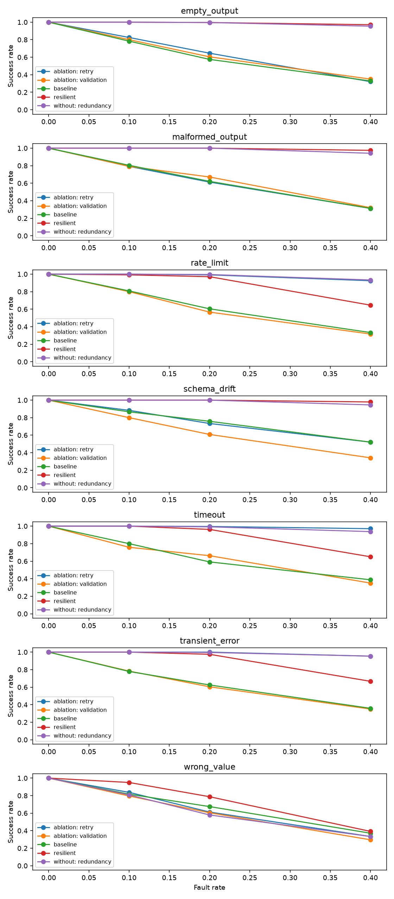
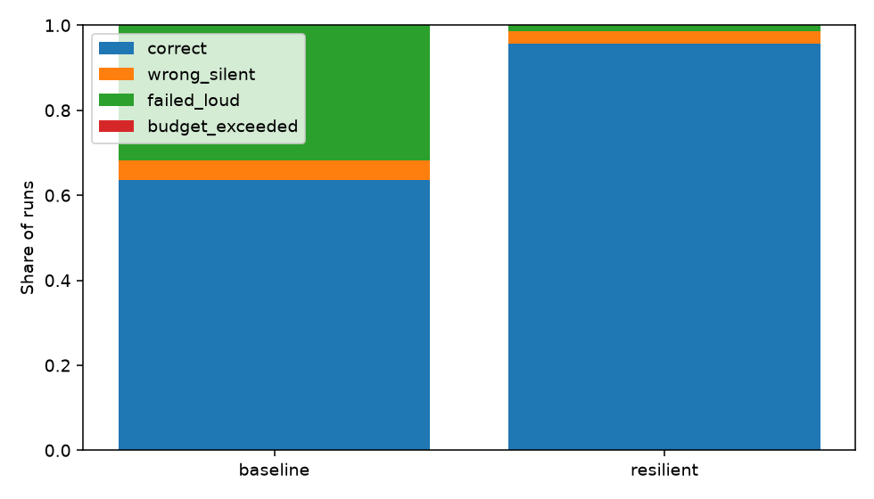
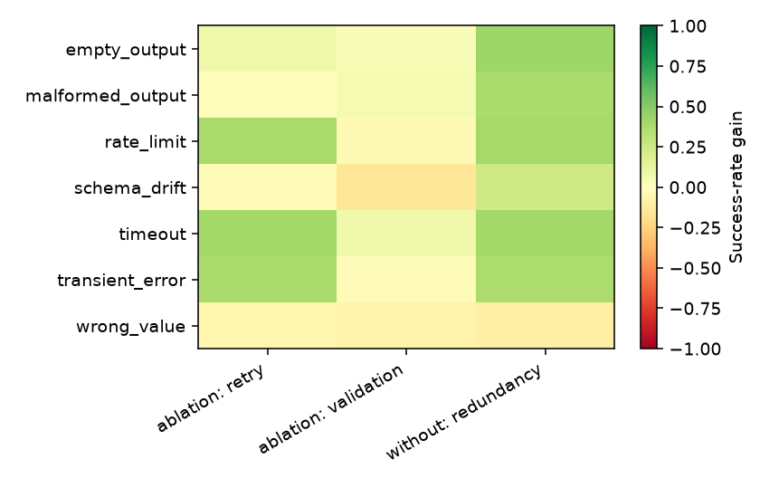

<p align="center">
  
</p>

<p align="center">
  <strong>Chaos testing for tool-using AI agents.</strong><br />
  Inject realistic tool failures, try resilience strategies, and measure what still goes wrong.
</p>

<p align="center">
  
  
  
</p>

## Why agent-chaos?

Tool-using agents depend on services that time out, return malformed data, change schemas, or quietly return the wrong value. A happy-path demo cannot tell you whether an agent will recover—or confidently give the wrong answer.

`agent-chaos` gives you a deterministic in-memory world, seeded fault injection, configurable mitigations, and an experiment runner that separates loud failures from silent wrong answers. The scripted agent runs locally without a model key or network calls.

## Quickstart

Requires Python 3.11 or newer.

```bash
python -m pip install -e ".[dev]"
chaos demo
```

The demo prints a compact comparison and writes the full outputs to `results/demo/`:

- `results.json` and `results.csv` — one row per run
- `report.md` — tables and chart embeds
- `charts/` — three PNG charts

To view the generated example report and figures, start with [`examples/sample_report.md`](examples/sample_report.md).

## What it breaks

Faults are deterministic for a given experiment seed and tool-call order.

| Fault | Injected behavior | Expected outcome |
|---|---|---|
| `timeout` | Virtual call latency exceeds its limit | Loud failure |
| `transient_error` | Temporary backend error | Loud failure |
| `rate_limit` | Rate-limit error with a retry delay | Loud failure |
| `malformed_output` | Truncated JSON or a non-dictionary response | Loud failure |
| `schema_drift` | Renamed field or changed output shape | Loud with validation; may crash without it |
| `empty_output` | Empty or null response | Usually loud |
| `wrong_value` | Plausible, typed, incorrect value | **Silent failure risk** |
| `latency_spike` | Adds virtual latency without changing the response | Latency/cost increase |

## What it tries

Each resilience stage can be enabled or disabled to compare a baseline, a resilient configuration, and ablations.


The executor uses a virtual clock, so timeouts, breaker recovery, and backoff do not sleep in real time. Retries help with transient and malformed responses; redundancy and invariants can help with some wrong values. The experiment measures the cases they do not catch, too.

## Results

These numbers come from [`experiments/default.yaml`](experiments/default.yaml), with 30 runs per cell across eight tasks. They are from the **scripted agent with simulated tools**. The table is the generated report at fault rate 0.2.

| Fault | Baseline success | Resilient success | Baseline silent failures | Resilient silent failures |
|---|---:|---:|---:|---:|
| `empty_output` | 57.5% | 99.6% | 0.0% | 0.0% |
| `malformed_output` | 62.1% | 100.0% | 0.0% | 0.0% |
| `rate_limit` | 60.4% | 97.1% | 0.0% | 0.0% |
| `schema_drift` | 75.8% | 100.0% | 0.0% | 0.0% |
| `timeout` | 59.2% | 96.2% | 0.0% | 0.0% |
| `transient_error` | 62.5% | 97.5% | 0.0% | 0.0% |
| `wrong_value` | 67.5% | 78.8% | 32.5% | **21.2%** |

### Degradation across fault rates



### Outcome mix at fault rate 0.2



### Ablation success-rate gain



The generated [sample report](examples/sample_report.md) includes the Wilson confidence intervals, per-tool outcome attribution, silent-failure breakdown for `wrong_value`, overhead by fault/rate/condition, and ablation results. Raw generated rows are in [`examples/sample_results.json`](examples/sample_results.json).

### What did not work

Wrong-value faults remain the main risk. At rate 0.2, the resilient condition still returned wrong answers silently in **21.2%** of runs. Retries cannot identify a plausible but incorrect value by themselves. Redundancy and invariants reduce some errors, but they do not provide a guarantee; use the generated report to see their measured effect.

## Run your own experiment

Run the complete default matrix and create a report:

```bash
chaos run --config experiments/default.yaml --out results/default
chaos report results/default/results.json \
  --out results/default/report.md \
  --charts-dir results/default/charts \
  --rate 0.2
```

Explore the available fault definitions:

```bash
chaos faults
```

Experiment YAML controls the seed, task set, fault probabilities, runs per cell, conditions, and retry settings. The output includes CSV and JSON results that can be analyzed independently.

## Optional Groq agent

The default and demo configurations use the scripted agent and need no key. To try the optional Groq agent, add `GROQ_API_KEY` and `GROQ_MODEL` to a local `.env` file (never commit it), then set `agent: groq` in an experiment YAML and run that configuration. This mode sends model requests to Groq; the simulated tools themselves remain in memory. Model output can vary, and results should be labeled separately from scripted runs.

## Design and limitations

- **Deterministic world:** known values give each task a ground-truth answer.
- **Virtual time:** timing-related experiments run without real sleeps.
- **Seeded faults:** repeat a run using the same configuration and seed.
- **Ablations:** compare the complete resilience setup with individual stages enabled or removed.
- **Silent failures are separate:** a returned wrong answer is not counted as a loud error.
- **Simulated tools only:** this project does not call real exchange-rate, travel, price, or fuel services.
- **Groq is optional:** scripted experiments do not make external model calls.

## Project layout

```text
src/agent_chaos/     clock, world, tools, faults, executor, agents, experiments, reports, CLI
experiments/         default and fast demo configurations
tests/               unit and regression tests
examples/            generated default-run data, report, and charts
prompts/             phased project build notes
```

## Development

```bash
python -m pip install -e ".[dev]"
python -m pytest
ruff check .
```

## License

MIT. See [`LICENSE`](LICENSE).
